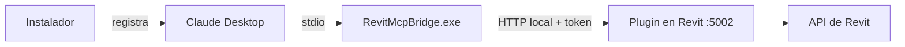
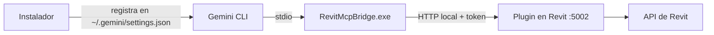
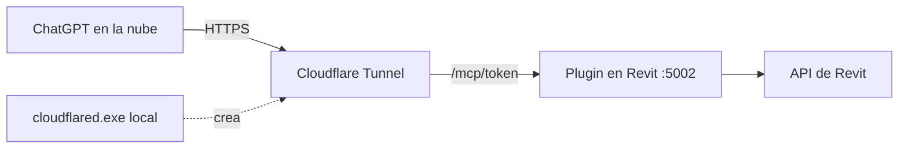

# RevitMCP — Digital Jump Peru

Servidor **MCP (Model Context Protocol)** que vive dentro de Autodesk Revit (**2021 a 2027**) y permite a cualquier IA compatible con MCP —Claude, ChatGPT, Gemini, Codex, Cursor, VS Code, LM Studio…— consultar y modificar modelos, crear familias paramétricas y exportar documentación.

> Versión 2.x: el servidor MCP está **dentro del add-in C#**. Ya no hay servidor Python ni puerto TCP propio.

```
Claude Desktop / Gemini CLI / Codex / Cursor / VS Code ──stdio──▶ RevitMcpBridge.exe ──HTTP + token──▶ Plugin C# (servidor MCP :5002) ──▶ API de Revit
Claude Code, clientes HTTP ───────────────────────── HTTP + token ────────────────────────────────▶
ChatGPT, servicios web ── HTTPS (túnel) ── /mcp/<token> (opcional, solo lectura por defecto) ─────────▶
```

Guía por cliente (Gemini, ChatGPT, OpenAI, Cursor…): [`docs/CLIENTES.md`](docs/CLIENTES.md).

## Instalación rápida

1. Descarga el instalador de tu versión de Revit (**2025, 2026 o 2027**) desde [**Releases**](https://github.com/kmezacivil-byte/revit-mcp/releases/latest): `RevitMcpPlugin_<año>_Setup.exe`. Para Revit 2021–2024 compila desde el código (ver [Compilar e instalar](#compilar-e-instalar)).
2. Cierra Revit y tu cliente de IA, ejecuta el instalador (registra el servidor `revit` en los clientes MCP que detecte) y abre Revit con un proyecto.
3. En Revit, pestaña **RevitMCP ▸ Cuenta DJP**: inicia sesión con tu cuenta DJP.
4. Conecta tu IA con uno de los tres flujos de abajo.

## Conectar con tu IA: tres flujos

Los tres usan el mismo servidor; solo cambia **cómo llega** el cliente hasta Revit.

| | Claude | Gemini | ChatGPT |
|---|---|---|---|
| Cliente | Claude Desktop / Claude Code | Gemini CLI (la app web no admite MCP propios) | ChatGPT (web/escritorio) |
| Transporte | stdio (puente) o HTTP local | stdio (puente) o HTTP local | **HTTPS público** (túnel) |
| Registro | Automático con el instalador | Automático con el instalador | Manual: pegar una URL |
| Acceso | Total | Total | **Solo lectura** por defecto |
| Necesita túnel | No | No | **Sí** (Cloudflare Tunnel) |

### Flujo 1 — Claude



1. Ejecuta el instalador: registra `revit` en **Claude Desktop** automáticamente.
2. Reinicia Claude Desktop con Revit abierto y un proyecto cargado. Comprueba en la lista de herramientas que aparece **revit**.
3. **Claude Code**: `claude mcp add revit -- "C:\Program Files\Digital Jump Peru\RevitMcpPlugin\2025\RevitMcpBridge.exe"` (o por HTTP con el token de `%LOCALAPPDATA%\RevitMCP\token.txt`, ver [`docs/CLIENTES.md`](docs/CLIENTES.md)).
4. Prueba: *«¿Cuántos muros tiene el proyecto?»* o *«captura la vista activa»*.

### Flujo 2 — Gemini



1. Ejecuta el instalador (o `RevitMcpBridge.exe --install gemini-cli`).
2. Abre una terminal y lanza `gemini`; con `/mcp` verás el servidor **revit** y sus herramientas.
3. La **app web de Gemini no admite servidores MCP propios**: usa Gemini CLI o la API de Gemini con el SDK (ejemplo en [`docs/CLIENTES.md`](docs/CLIENTES.md)).
4. Si el modelo rinde peor con muchas herramientas, elige el perfil **solo lectura**, **modelado** o **familias** en **RevitMCP ▸ Configuración MCP**.

### Flujo 3 — ChatGPT



ChatGPT no llega a `localhost`: necesita una dirección pública. Por eso el acceso remoto está **desactivado por defecto**.

1. Descarga `cloudflared-windows-amd64.exe` de [cloudflared/releases](https://github.com/cloudflare/cloudflared/releases/latest) y déjalo en Descargas (no se instala ni se abre con doble clic).
2. En Revit: **RevitMCP ▸ Configuración MCP ▸ Acceso remoto ▸ Permitir acceso remoto** (empieza en **solo lectura**).
3. Pulsa **Iniciar túnel** (o **Detectar túnel** si ya lo tienes corriendo): la ventana rellena la dirección pública.
4. Pulsa **Copiar dirección para ChatGPT**.
5. En ChatGPT: **Complementos ▸ Añadir servidor MCP personalizado** (con el modo desarrollador habilitado según tu plan), pega la dirección en **URL del servidor** y deja **Sin autenticación**.
6. La dirección contiene el token y **es la credencial**: no la compartas; regenera el token si se filtra. Los túneles rápidos cambian de dirección al reiniciarse.

> Los planes personales de ChatGPT pueden limitar los conectores a solo lectura; el acceso remoto de RevitMCP ya empieza en solo lectura por seguridad.

- **Plugin** (`plugin/`): implementa MCP (Streamable HTTP sin estado, spec 2026-07-28 con compatibilidad hacia atrás) en `http://127.0.0.1:5002/mcp`. Solo escucha en local y exige `Authorization: Bearer <token>`; el token se genera en `%LOCALAPPDATA%\RevitMCP\token.txt`.
- **Puente** (`bridge/`): programa .NET Framework 4.8 que traduce stdio ⇄ HTTP para clientes que solo lanzan procesos locales (Claude Desktop). Avisa con `notifications/tools/list_changed` cuando cambia la lista de herramientas.
- **Instalador** (`plugin/RevitMcpPlugin.iss`, Inno Setup): instala el plugin para un año de Revit y registra el servidor `revit` en los clientes MCP detectados (Claude Desktop, Gemini CLI, Cursor, VS Code, Codex CLI). `RevitMcpBridge.exe --list | --install | --uninstall` lo hace a mano.

## Compilar e instalar

Requisitos: .NET SDK, Inno Setup 6 y Revit instalado (las DLL de Revit se referencian desde `C:\Program Files\Autodesk\Revit <año>`).

```bat
plugin\empaquetar.bat 2025      :: genera installer\RevitMcpPlugin_2025_Setup.exe  (años 2021 a 2027)
```

Revit 2021–2024 se compilan para .NET Framework 4.8, 2025 y 2026 para .NET 8 y 2027 para .NET 10. Si el año pedido no está instalado, la API de Revit se toma de NuGet (`Nice3point.Revit.Api.*`), así que se puede compilar cualquier año; **la versión que se ha ejecutado y probado de verdad dentro de Revit es la 2025**; el resto (2021–2024, 2026 y 2027) compila sin errores pero aún no se ha verificado en Revit.

Cierra Revit y tu cliente de IA, ejecuta el instalador, abre Revit con un proyecto y reinicia el cliente una vez.

## Herramientas (79)

| Grupo | Herramientas |
|---|---|
| Consulta | `ping`, `get_project_info`, `get_levels`, `get_rooms`, `get_sheets`, `get_views`, `get_view_info`, `get_view_elements`, `get_selection`, `get_categories`, `get_families`, `get_system_types`, `get_elements_by_category`, `filter_elements`, `get_element_properties`, `get_model_statistics`, `get_material_quantities`, `get_mep_types`, `get_family_geometry` |
| Crear | `create_level`, `create_grid`, `create_floor`, `create_roof`, `create_room`, `create_sheet`, `create_view` (planta, 3D, sección), `create_wall`, `create_door`, `create_window`, `create_duct`, `create_pipe`, `place_family_instance`, `duplicate_type`, `create_wall_type_with_layers`, `create_pipe_type`, `create_pipe_fitting_connect`, `place_plumbing_fixture` |
| Modificar | `set_parameter`, `change_element_type`, `move_elements`, `rotate_elements`, `color_elements`, `clear_color_overrides`, `tag_elements`, `select_elements`, `set_active_view`, `delete_elements`, `attach_wall_to_roof` (Revit 2025+) |
| Análisis y salida | `capture_view` (devuelve la imagen al modelo), `detect_clashes`, `export_pdf`, `export_image`, `export_ifc`, `link_revit_file`, `load_family`, `save_document` |
| Familias | `create_family`, `save_family`, `close_family`, `list_open_families`, `list_family_templates`, `add_family_parameter`, `set_family_formula`, `create_family_type`, `activate_family_type`, `set_family_type_value`, `list_family_parameters`, `create_reference_plane`, `create_family_dimension`, `create_extrusion`, `create_sweep`, `create_revolution`, `align_to_plane`, `associate_family_material`, `list_family_elements`, `nest_family`, `associate_nested_parameter`, `build_family_from_spec` |
| Código a medida | `execute_code` (opcional, solo Revit 2025) |

Convenciones: nombres de tools en inglés, descripciones y parámetros en español; longitudes en **metros** (o con unidad, `"125 mm"`), ángulos en **grados**; todo cambio va en una `Transaction` con nombre (Ctrl+Z lo deshace). Las acciones que borran o modifican en masa exigen `confirmar=true`. Cada tool nueva es una clase que hereda de `McpTool` (`plugin/Core/ToolBase.cs`) y se registra sola por reflexión.

### Familias paramétricas

`create_extrusion` dibuja perfiles predefinidos (`rectangulo`, `circulo`, `anillo`, `cajon`, `perfil_I`, `perfil_C`, `perfil_L`, `poligono`) cuyas medidas siguen a parámetros de la familia: crea planos de referencia, cotas etiquetadas y alineaciones bloqueadas. `centro:[u,v]` desplaza el perfil (valor fijo o parámetro). `build_family_from_spec` construye una familia completa desde un JSON; hay ejemplos en [`ejemplos/familias/`](ejemplos/familias) (tubo hueco, cajón, IPE120, placa, cajón de trasvase, pescante giratorio).

Notas de la API de Revit descubiertas en el camino:
- `GenericForm.Name` no se puede asignar (lanza `InvalidOperationException` con un mensaje engañoso): los nombres de pieza viven en el registro de la sesión.
- `NewSweep` solo acepta el perfil en el plano XY con el camino saliendo hacia +Z; los barridos horizontales o inclinados se construyen así y luego se giran.

## Configuración desde Revit

La pestaña **RevitMCP ▸ Configuración MCP** permite elegir el **perfil de herramientas** (completo, modelado, familias, solo lectura; menos herramientas ayudan a algunos modelos), activar `execute_code` y activar el **acceso remoto** para ChatGPT. Todo se guarda en `%LOCALAPPDATA%\RevitMCP\config.json`, que ninguna herramienta MCP puede modificar.

## Cuenta DJP (inicio de sesión)

Las herramientas exigen iniciar sesión con una cuenta DJP (Supabase, correo y contraseña). Revit ofrece la ventana al arrancar; también está en **RevitMCP ▸ Cuenta DJP** y en la ventana de configuración. La sesión se guarda cifrada con DPAPI en `HKCU\SOFTWARE\DJP\RevitMCP` y se renueva sola. Sin sesión, `ping` y `tools/list` funcionan y el resto de herramientas devuelve "Inicia sesión con tu cuenta DJP…". Se puede desactivar en la configuración (`autenticacion.requerida` en `config.json`) o con `REVITMCP_AUTH=0` en pruebas. El proyecto de Supabase se puede sustituir con `DJP_SUPABASE_URL` y `DJP_SUPABASE_ANON_KEY`.

> Es una puerta de producto en el cliente, no un límite de seguridad: el código es abierto. Lo que deba protegerse de verdad se valida en el servidor con el JWT.

## Interfaz y guía de diseño

Las ventanas usan el sistema de diseño DJP (carbón `#081013`, dorado `#DDA40F`, Poppins con Segoe UI de respaldo) en `plugin/Ui/DjpTheme.cs` y `DjpUi.cs`. La guía para reutilizarlo en otros add-ins de Autodesk está en [docs/GUIA_WPF_ADDINS_AUTODESK.md](docs/GUIA_WPF_ADDINS_AUTODESK.md).

## execute_code (opcional)

Permite a la IA ejecutar C# dentro de Revit (Roslyn) cuando ninguna tool sirve. **Desactivada por defecto**, solo Revit 2025 o superior. Se activa desde la pestaña **RevitMCP ▸ Configuración MCP** (guarda `%LOCALAPPDATA%\RevitMCP\config.json`; ninguna tool MCP puede modificarlo). Modos: `solo_leer` (transacción que siempre se revierte) y `modificar` (permiso aparte + `confirmar=true`). Bloquea archivos, red, procesos, reflexión, `dynamic` y guardar/cerrar/exportar documentos; cada ejecución se registra en `execute_code.log`. Es una red de seguridad, **no un sandbox**.

## Limitaciones conocidas

- El giro parametrizado del brazo del pescante (±90°), pernos, topes y compuerta abatible no están resueltos.
- Los barridos y revoluciones y el perfil `poligono` tienen dimensiones fijas.
- Un script de `execute_code` que ignore `Cancel` no se puede interrumpir.
- En el equipo de desarrollo, fijar `ContentLength64` en `HttpListener` producía respuestas vacías; el servidor responde siempre en *chunked*.

Más contexto histórico en [`LESSONS_LEARNED.md`](LESSONS_LEARNED.md) (parte describe la arquitectura 1.x con Python).
